# FFIM Gather

FFIM Gather helps our church visit every house in our area, remember who we met, and keep checking on our members.

This page shows how to use it. If you are setting the app up, see [docs/SETUP.md](docs/SETUP.md).

**Contents**

- [For everyone](#for-everyone)
- [For zone pastors](#for-zone-pastors)
- [For admins](#for-admins)
- [Quick answers](#quick-answers)

---

## For everyone

### 1. Put the app on your phone

Open the link your pastor sent you.

- **Android:** tap **Install app** on the sign-in screen, or go to **Me** and tap **Install on this phone**.
- **iPhone:** in Safari, tap **Share**, then **Add to Home Screen**.

After that, open **Gather** from its icon. It opens full screen like any other app.

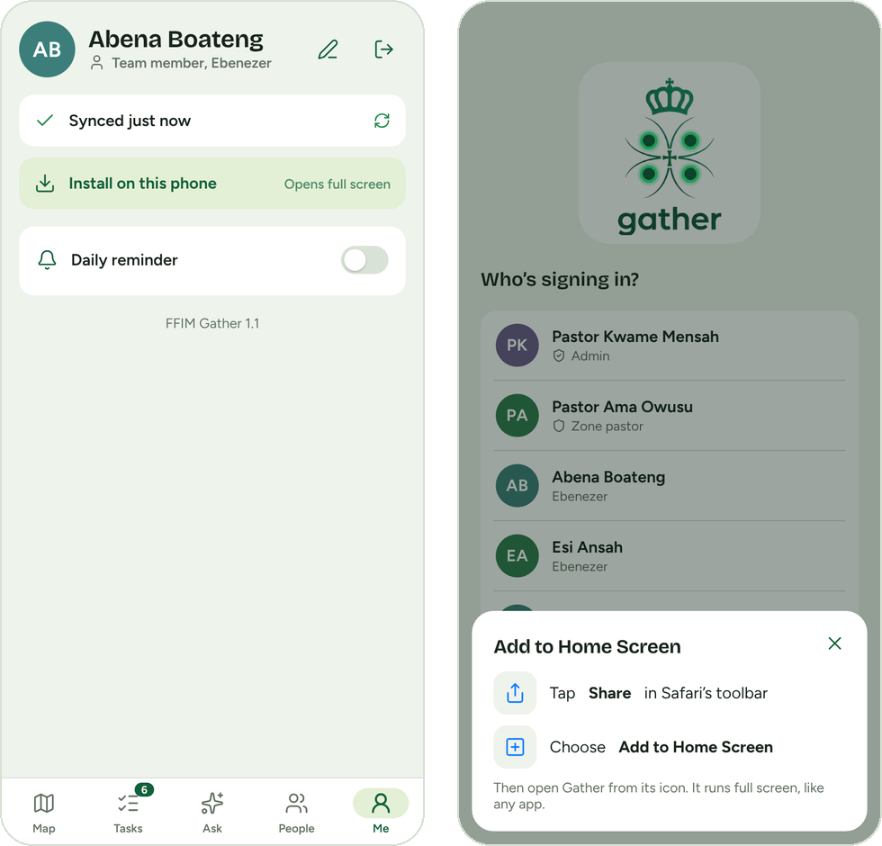

### 2. Sign in

Tap your name. No password is needed.

If your name isn't on the list, ask your zone pastor to add you.

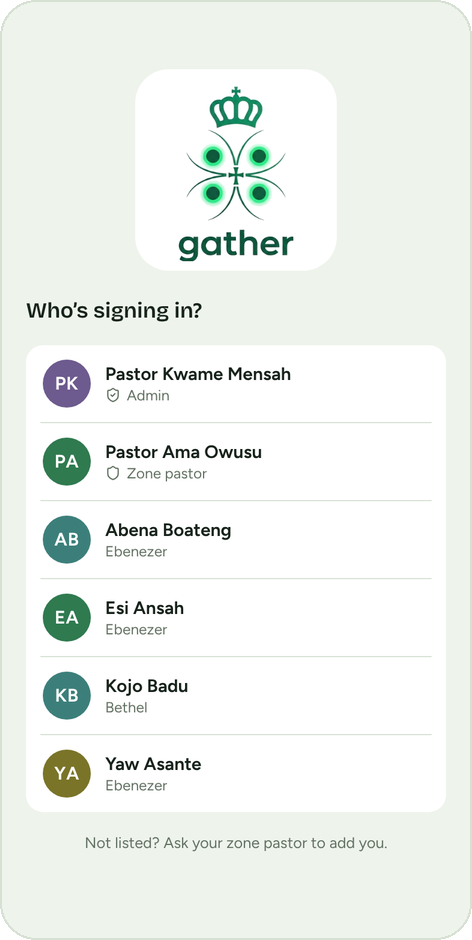

### 3. Read the map

Every dot is a house. Its colour tells you what to do.

| Dot | Means | What to do |
|---|---|---|
|  Red | Not visited yet | Go and share the gospel |
|  Orange | Visited before, not this week | Follow up |
|  Yellow | Visited this week | Nothing this week. It turns orange next Monday |
|  Green | Church members live here | Check on them |
|  Blue ring | Empty house, nobody lives here | Skip it for now |
|  Grey | Do not visit | Skip it |

A dark circle around a dot means the house is one of **your tasks**.

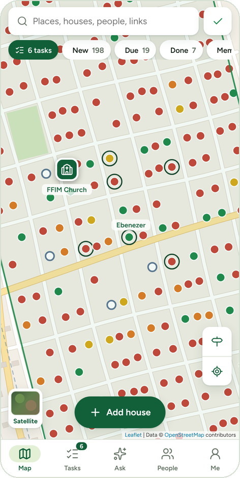

### 4. Jump to the church or a zone

Tap the **signpost button** on the right side of the map. Then pick the church, one of your zones, or **All my houses**, and the map takes you there.

To get directions to a house, open the house and tap the **blue arrow** at the top. Google Maps opens with directions from where you are.

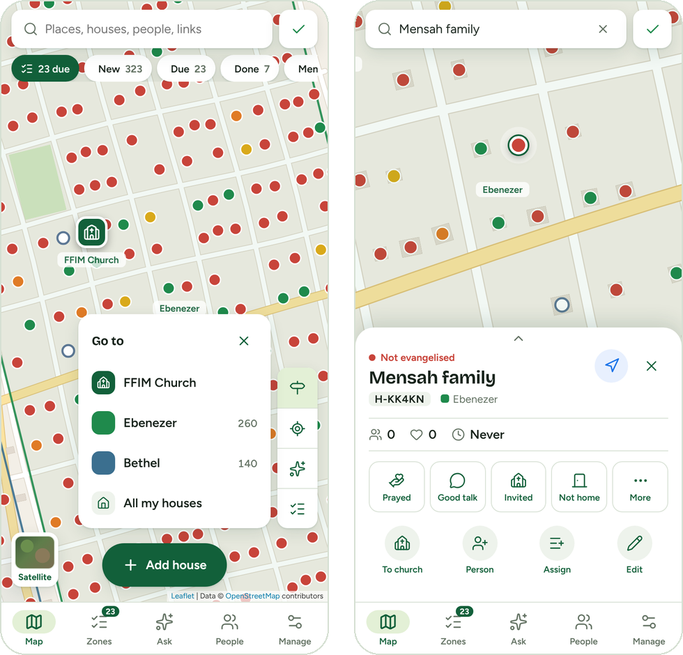

### 5. See your tasks

Tap **Tasks**. It shows the houses your pastor gave you, starting with the most urgent.

- Tap the **arrow** to get directions.
- Tap the **green tick** when you're done.

Below your tasks, **Due in your zone** lists other houses that need a follow-up.

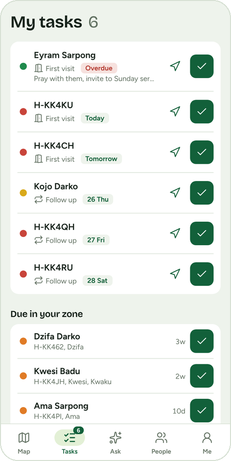

### 6. Record a visit in one tap

Tap a house on the map. Then tap what happened: **Prayed**, **Good talk**, **Invited** or **Not home**.

That's it. The visit is saved and the house turns yellow. If it was one of your tasks, the task is marked done.

Made a mistake? Tap **Undo**.

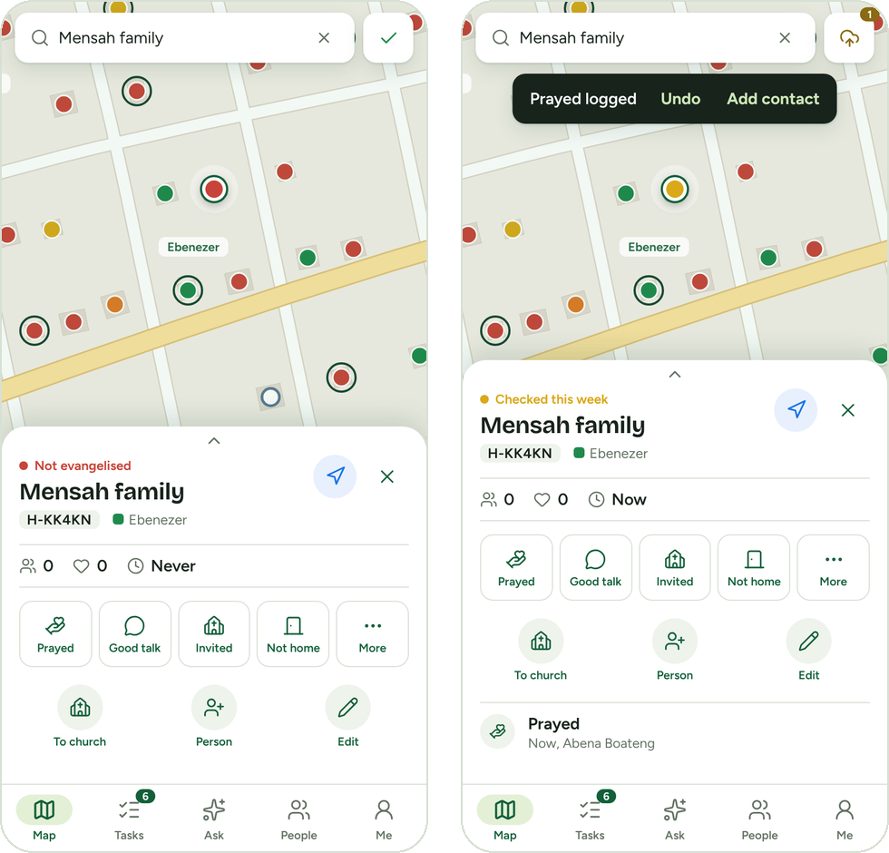

### 7. Save the person you met

After a visit, tap **Add contact** in the message at the top. You can also tap **Person** on the house.

Type their name and phone number, then tap **Save**.

If the person is already on the church's list, they show up as you type. Tap **Use** so you don't have to type everything again.

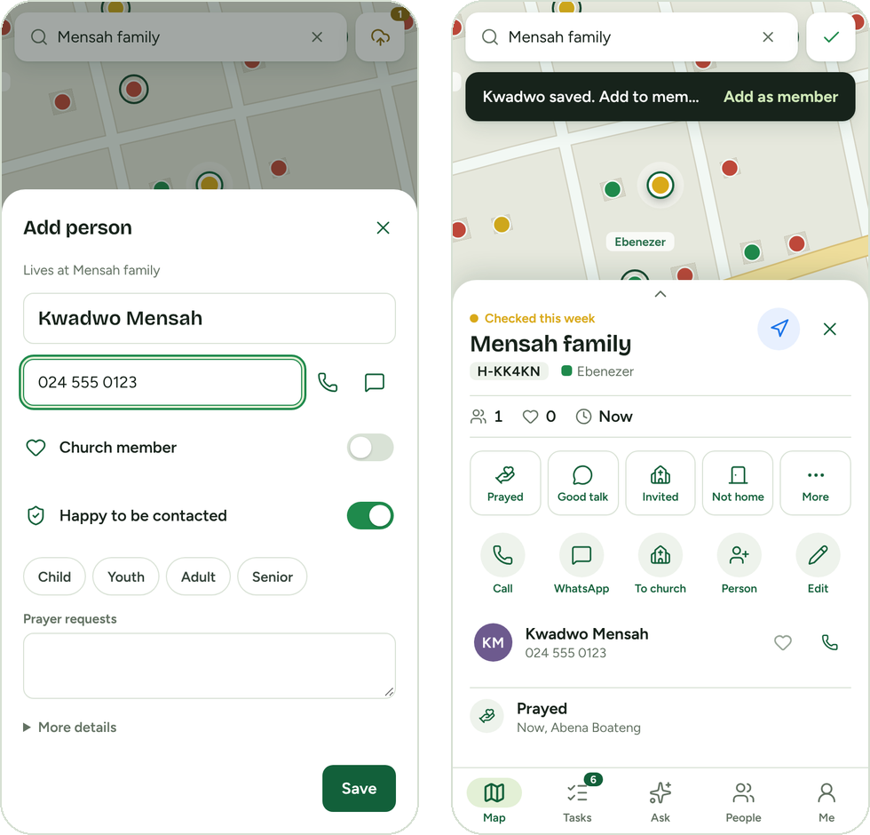

### 8. Someone joined the church

Tap the **heart** next to their name. It turns green, and so does their house.

From then on, the house shows up in the weekly member check-ups.

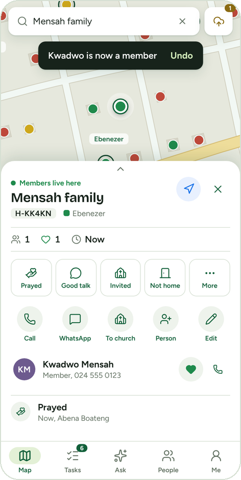

### 9. The house is empty

If nobody lives in a house (empty, unfinished or abandoned), tap **Not home**, then tap **House is empty**.

The dot becomes a blue ring and stops showing up as a follow-up. If people move in later, tap **Lived in now**.

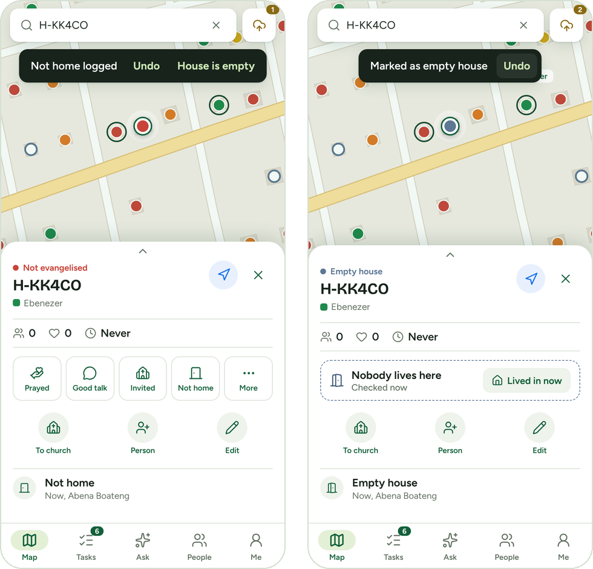

### 10. A house is missing from the map

1. Tap **Add house**.
2. Tap the exact spot on the map.

The new pin appears there. If it's in the wrong place, press and drag it to the right spot.

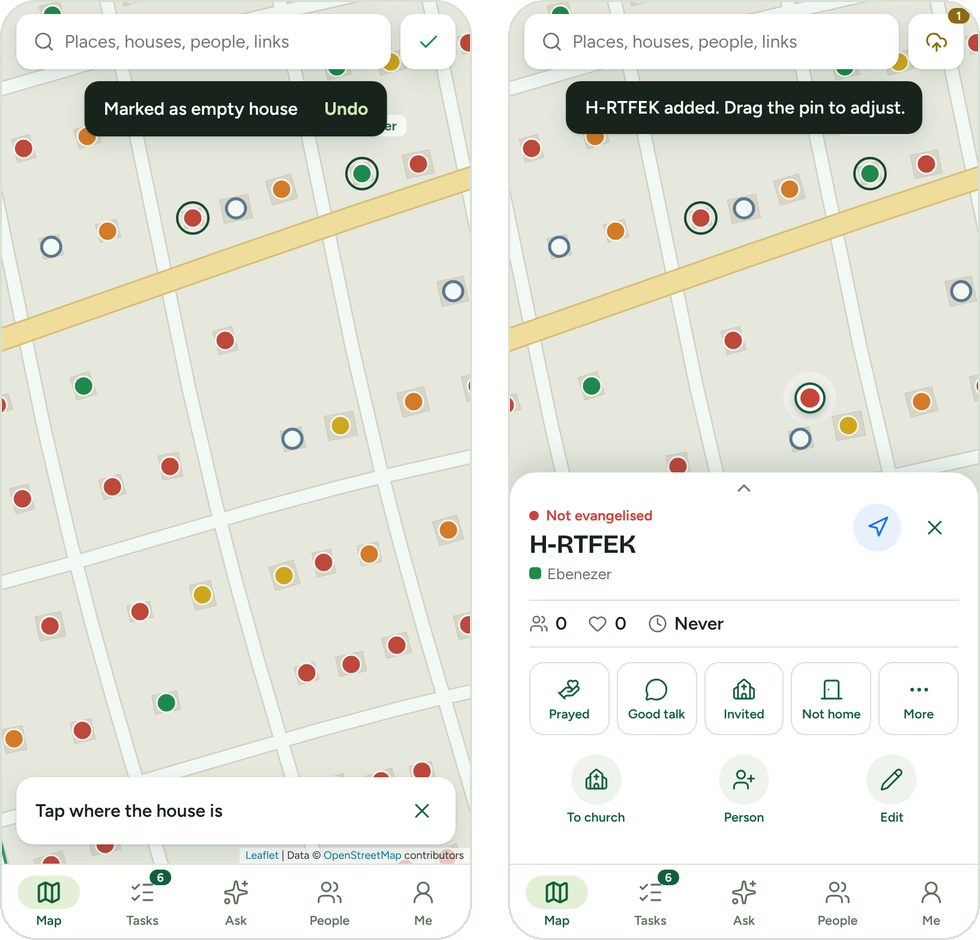

### 11. Ask Gather

Tap **Ask**. You can type, or tap the **mic** and speak.

- *"What are my tasks today?"*
- *"Who is due near me?"*
- *"I visited the Mensah family and invited Kwadwo to church."*

Before Gather changes anything, it shows you what it will do. Tap **Confirm** to save it, or **Cancel**.

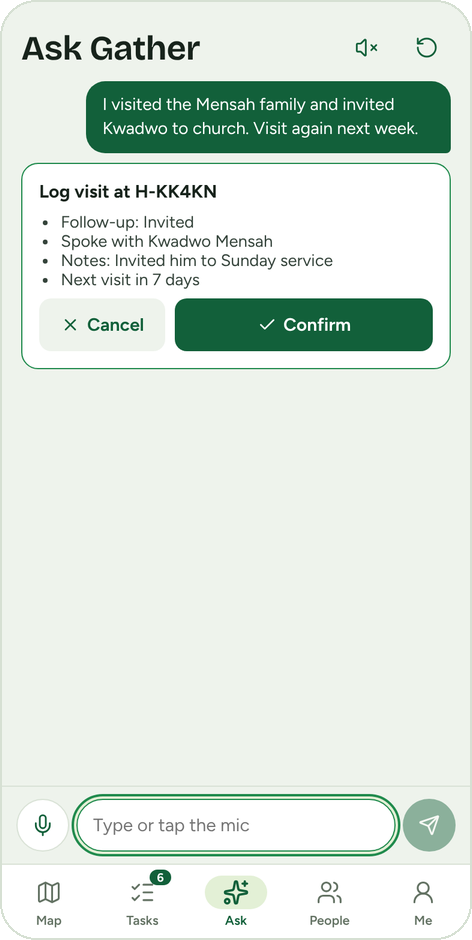

### 12. No network? Keep going

Everything you do is saved on your phone first, and it goes to the church's records when you're back online.

The button at the top right of the map shows a **tick** when everything is saved. A **number** there means that many changes are waiting to be sent.

---

## For zone pastors

You can do everything above, plus the following.

### See how your zone is doing

Tap **Zones**. The bar shows how much of your zone has been reached:

- green: members
- yellow: visited this week
- orange: follow-up due
- red: not visited yet

The lists below it show houses that are **Due**, **New** (never visited), **Members** and **Assigned**.

Tap **Nearest to church** to sort houses by how far they are by road.

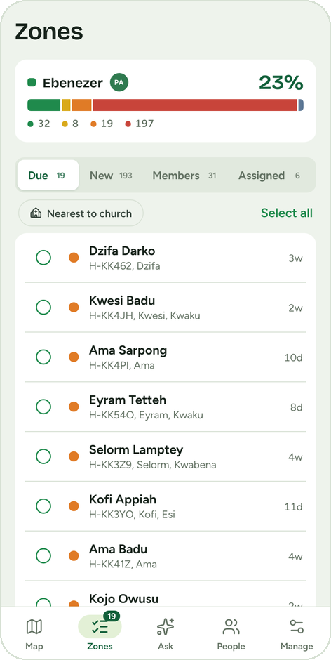

### Give houses to your team

1. Tick the houses in a list (or tap **Select all**).
2. Tap **Assign**.
3. Pick a person, what to do (**First visit**, **Follow up**, **Member care**…) and when.
4. Tap **Assign**.

The houses then show up in that person's **Tasks**.

To pick houses on the map instead, tap the **checklist button** on the right side of the map, then tap the houses.

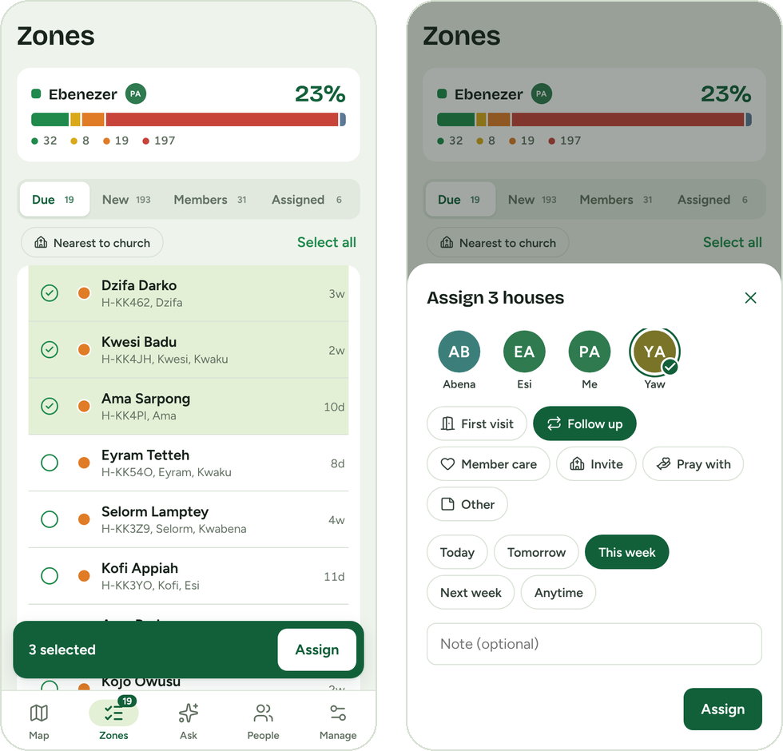

### Add people to your team

1. Go to **Manage** and tap the **+** next to **Team**.
2. Type their name and phone number, then tap **Add**.

They can sign in right away by tapping their name.

**Tidy up pins** checks the map for you. It removes dots that aren't really buildings, removes a second dot on the same building, and adds homes that were missed. Houses you've worked with (visits, people, notes) are never removed.

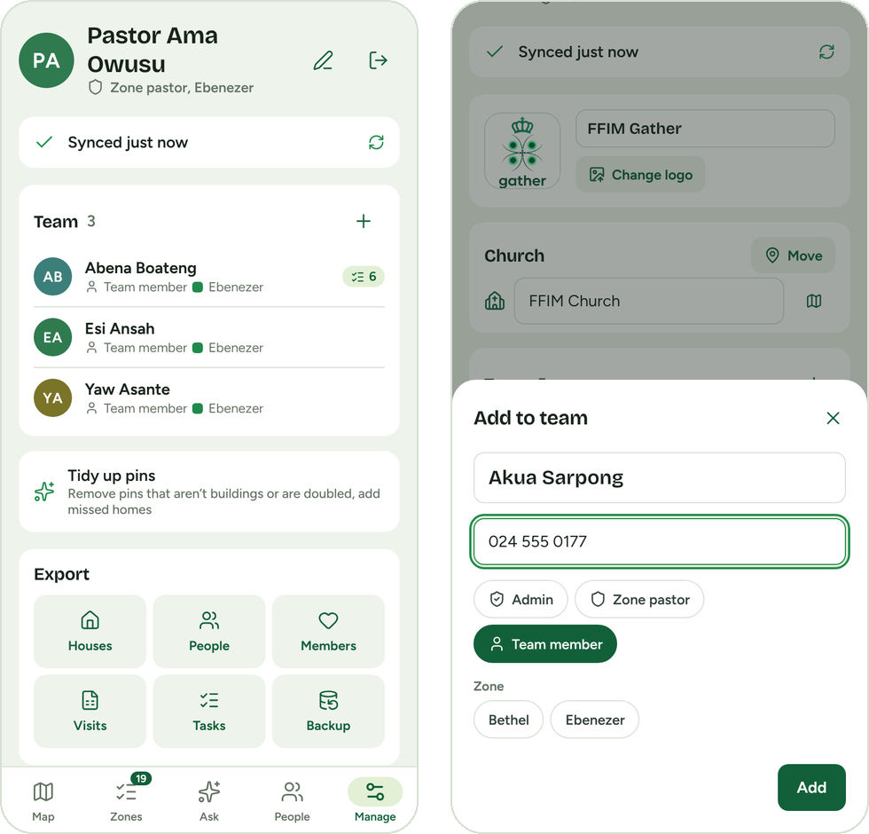

### Fill your zone with houses

Tap the **sparkle button** on the map. The app finds the homes on screen or in your zone and puts a red dot on each one.

---

## For admins

You can do everything above, plus the following.

- **Draw a zone:** go to **Manage** and tap **Draw zone**. Search for the area's name, or tap its corners on the map. Then tap the tick, give the zone a name and choose its zone pastor. To remove a corner, tap it.
- **Mark the church:** go to **Manage**, then **Church**, then **Set on map**, and tap the church building. After that, anyone can open a house and tap **To church** to see the road distance and walking time.
- **Logo and name:** go to **Manage** and tap **Change logo**.
- **Export:** under **Manage**, you can download houses, people, members, visits and tasks as spreadsheets, or make a full backup.

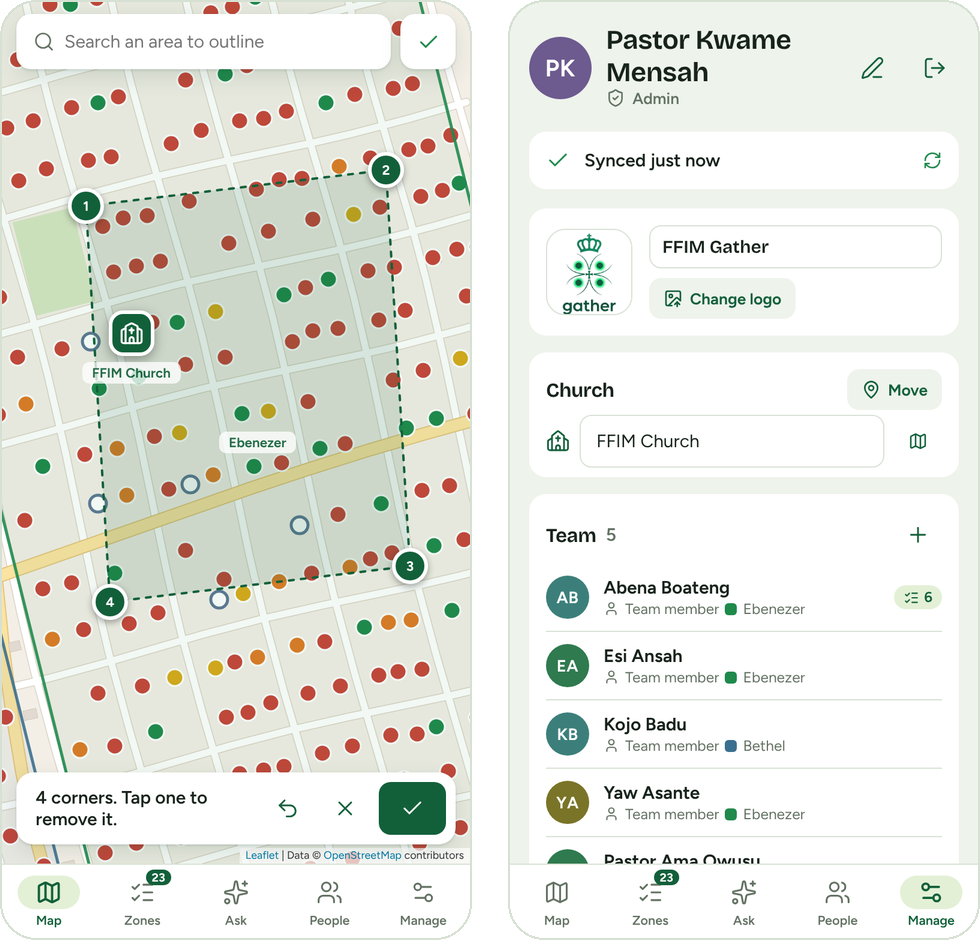

---

## Quick answers

**I tapped the wrong button.**
Tap **Undo** in the message at the top of the screen.

**The pin is in the wrong place.**
Tap the house, then press and drag its pin.

**A dot isn't a real house.**
Tell your zone pastor. They can delete it (tap it, then **Edit**) or run **Tidy up pins** to clean up the whole map.

**Someone doesn't want visits.**
Tap the house, tap **Edit**, and switch on **Do not visit**. The dot turns grey.

**How do I get to a house?**
Open the house and tap the blue arrow at the top for directions in Google Maps. On a task, tap its arrow.

**Where are my changes?**
Look at the button at the top right of the map. A tick means everything is saved. A number means changes are waiting to be sent, which happens as soon as you're online.

**Who can see what?**
Team members see their own zone. Zone pastors see their zones. Admins see everything.

---

*The pictures in this guide use made-up names and a made-up neighbourhood.*
